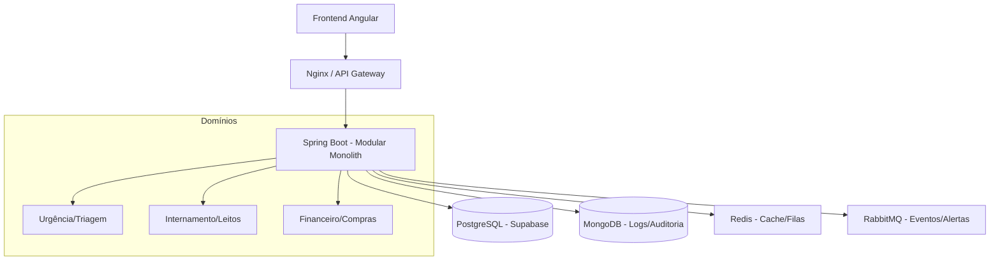

# Fabrica de IA Autonoma - Relatorio Final

**Ideia:** Sistema de Gestão Hospitalar Pública (HIS)

## scrum_master

_Modelo: gemini-3.1-flash-lite_

Como Scrum Master, apresento o Backlog da **Versão 0.1 (MVP - Mínimo Produto Viável)** para o Sistema de Gestão Hospitalar (HIS). O foco desta versão é garantir a **estabilidade da jornada clínica básica** e a **segurança da informação (RBAC/Auditoria)**.

---

### Sprint 1: Fundação, Segurança e Admissão (Duração: 2 semanas)
*Objetivo: Estabelecer a infraestrutura base e permitir a entrada de pacientes no sistema.*

1. **US01 - Autenticação e RBAC (Alta)**
   - **História:** Como utilizador, quero autenticar-me no sistema para aceder apenas às funcionalidades do meu perfil.
   - **Critérios de Aceitação:**
     - Login com e-mail e password.
     - Implementação de perfis (Médico, Enfermeiro, Rececionista, Admin).
     - Bloqueio de acesso a módulos não autorizados (ex: Rececionista não acede a prontuário clínico).
2. **US02 - Registo de Admissão de Paciente (Alta)**
   - **História:** Como rececionista, quero registar a entrada de um paciente para iniciar o seu percurso clínico.
   - **Critérios de Aceitação:**
     - Formulário com dados básicos (Nome, ID, Data Nascimento).
     - Geração de número de episódio único.
     - Suporte a "Paciente Desconhecido" para casos de emergência.
3. **US03 - Trilha de Auditoria (Alta)**
   - **História:** Como auditor, quero que todas as ações críticas sejam registadas para garantir a conformidade.
   - **Critérios de Aceitação:**
     - Registo automático de `utilizador_id`, `acao`, `timestamp` e `ip` em cada transação.
     - Tabela de auditoria imutável no PostgreSQL.

---

### Sprint 2: Fluxo Clínico de Urgência (Duração: 2 semanas)
*Objetivo: Permitir a triagem e o atendimento médico inicial.*

4. **US04 - Triagem de Risco (Alta)**
   - **História:** Como enfermeiro, quero classificar o risco do paciente para definir a prioridade de atendimento.
   - **Critérios de Aceitação:**
     - Registo de sinais vitais e queixa principal.
     - Aplicação da escala de Manchester (cores).
     - Atualização automática do estado do episódio para `AGUARDANDO_MEDICO`.
5. **US05 - Prontuário Médico (Alta)**
   - **História:** Como médico, quero registar a anamnese e hipótese diagnóstica para documentar o atendimento.
   - **Critérios de Aceitação:**
     - Interface de texto para evolução clínica.
     - Associação da evolução ao episódio de urgência ativo.
     - Validação de que apenas o médico responsável pode editar a evolução.

---

### Sprint 3: Prescrição e Gestão de Leitos (Duração: 2 semanas)
*Objetivo: Fechar o ciclo assistencial básico.*

6. **US06 - Prescrição Médica (Alta)**
   - **História:** Como médico, quero prescrever medicação para que a enfermagem possa administrar.
   - **Critérios de Aceitação:**
     - Seleção de fármaco e dosagem.
     - Validação de obrigatoriedade de assinatura digital/eletrónica.
     - Bloqueio de prescrição sem episódio ativo.
7. **US07 - Gestão de Leitos (Média)**
   - **História:** Como enfermeiro-chefe, quero alocar um leito para um paciente internado.
   - **Critérios de Aceitação:**
     - Visualização de estado dos leitos (Livre, Ocupado, Higienização).
     - Impedimento de alocação em leito com estado `AGUARDANDO_HIGIENIZACAO`.
     - Disparo de evento `AltaMedicaRegistada` para o módulo de limpeza.

---

### Resumo do Backlog (Prioridades)

| ID | História | Prioridade | Sprint |
| :--- | :--- | :--- | :--- |
| US01 | Autenticação e RBAC | Crítica | 1 |
| US02 | Admissão de Paciente | Crítica | 1 |
| US03 | Trilha de Auditoria | Crítica | 1 |
| US04 | Triagem de Risco | Alta | 2 |
| US05 | Prontuário Médico | Alta | 2 |
| US06 | Prescrição Médica | Alta | 3 |
| US07 | Gestão de Leitos | Média | 3 |

---

### Notas para a Equipa de Desenvolvimento
* **Comunicação:** Utilizar o canal de eventos para garantir que o módulo de `Higienização` receba o alerta de `AltaMedicaRegistada` de forma assíncrona (RabbitMQ).
* **Qualidade:** Todos os critérios de aceitação devem ser validados através de testes de integração antes da conclusão da tarefa.
* **Segurança:** O acesso a dados sensíveis deve ser sempre filtrado pelo perfil do utilizador (RBAC) no nível da API.

---

## arquiteto

_Modelo: gemini-3.1-flash-lite_

Como Arquiteto de Software, apresento a proposta de arquitetura para o Sistema de Gestão Hospitalar (HIS), focada em modularidade, integridade transacional e escalabilidade, seguindo as diretrizes de arquitetura híbrida e modular.

---

### 1. Stack Tecnológica Recomendada
A escolha prioriza a robustez do ecossistema Java para o core transacional e a flexibilidade do PostgreSQL para a consistência dos dados.

*   **Backend:** Java 21 + Spring Boot (Arquitetura Modular Monolith).
*   **Banco de Dados Relacional (Core):** Supabase (PostgreSQL) – Gestão de prontuários, escalas, estoques e transações financeiras (ACID).
*   **Banco de Dados NoSQL (Logs/Eventos):** MongoDB Atlas – Armazenamento de trilhas de auditoria, logs de sistema e telemetria de dispositivos médicos.
*   **Cache/Filas:** Redis (Sessões, rate limiting, painéis de urgência em tempo real).
*   **Frontend:** Angular (TypeScript) – Padronização corporativa para formulários complexos e dashboards.
*   **Infraestrutura:** Docker + Nginx (Load Balancer) + GitHub Actions (CI/CD).

---

### 2. Arquitetura em Camadas (Modular Monolith)

A estrutura é organizada por **Bounded Contexts** (Domínios), garantindo que a lógica de negócio de um módulo não contamine o outro.

#### A. Camada de Apresentação (Frontend)
*   **UI/UX:** Componentes reutilizáveis (Angular Material).
*   **Comunicação:** API Gateway (Nginx) roteando requisições para o backend.

#### B. Camada de Aplicação (Backend)
*   **API Layer:** Controllers RESTful com validação de DTOs.
*   **Service Layer:** Orquestração de regras de negócio e Máquinas de Estado (ex: transição de leitos).
*   **Domain Layer:** Entidades de negócio e lógica de domínio pura.
*   **Infrastructure Layer:** Implementação de repositórios (Spring Data JPA) e integração com mensageria (RabbitMQ/Outbox Pattern).

#### C. Camada de Persistência (Híbrida)
*   **PostgreSQL (Supabase):** Tabelas particionadas para dados sensíveis e transacionais.
*   **MongoDB Atlas:** Coleções de documentos para logs de auditoria imutáveis e dados não estruturados.

---

### 3. Limites e Regras de Segurança (RBAC/SoD)

Para garantir a integridade exigida num hospital público, aplicamos:

1.  **Segregação de Funções (SoD):** A camada de serviço impede que o mesmo ID de utilizador execute ações de "Solicitação" e "Aprovação" no mesmo fluxo financeiro.
2.  **Trilha de Auditoria:** Interceptores Spring registam todas as mutações de dados no MongoDB, capturando `user_id`, `action`, `previous_state` e `new_state`.
3.  **Break-the-Glass:** Endpoint de emergência que, ao ser acionado, eleva o nível de log para "Crítico" e dispara notificação assíncrona para a Auditoria Interna via mensageria.

---

### 4. Diagrama de Fluxo de Dados (Resumo)



---

### 5. Verificação de Conformidade
*   **Escalabilidade:** O backend é *stateless*, permitindo a replicação de instâncias conforme a carga.
*   **Manutenção:** A separação por módulos permite que a equipa de "Urgência" trabalhe independentemente da equipa de "Financeiro".
*   **Segurança:** RBAC implementado via JWT com escopos definidos pela matriz de permissões do hospital.

---

## programador

_Modelo: gemini-3.1-flash-lite_

Este plano de implementação organiza o desenvolvimento do Sistema de Gestão Hospitalar (HIS) numa abordagem de **Monólito Modular**, garantindo a separação de domínios e a integridade exigida num ambiente público.

---

### 1. Estrutura de Diretórios (Modular Monolith)
A estrutura reflete a separação por *Bounded Contexts* para facilitar a futura extração para microsserviços.

```text
/src
  /modules
    /urgencia          # Triagem, Admissão, Fluxo de Manchester
    /ambulatorio       # Consultas, Agendamentos
    /internamento      # Gestão de Leitos, Bloco Operatório, UCI
    /mdt               # Laboratório, Imagiologia, Farmácia
    /administrativo    # RH, Compras, Finanças, Logística
    /governacao        # Auditoria, Jurídico, Dashboards BI
  /shared
    /infrastructure    # Database, Redis, RabbitMQ, Logger
    /security          # RBAC/ABAC, JWT, Audit Trail Interceptors
    /events            # Event Bus (Domain Events)
```

---

### 2. Plano de Implementação (Fases)

#### Fase 1: Fundação e Segurança (Sprint 1-2)
*   **Objetivo:** Configurar o core de segurança e a trilha de auditoria.
*   **Ficheiros:** `shared/security/rbac.ts`, `shared/infrastructure/audit_interceptor.ts`.
*   **Ação:** Implementar o padrão de *Audit Trail* imutável que intercepta todas as operações de escrita (POST/PUT/DELETE) e regista o `utilizador_id`, `perfil`, `dados_anteriores` e `dados_novos`.

#### Fase 2: Ciclo Assistencial - Urgência e Internamento (Sprint 3-6)
*   **Objetivo:** Implementar as Máquinas de Estado para pacientes.
*   **Ficheiros:** `modules/urgencia/state_machine.ts`, `modules/internamento/bed_manager.ts`.
*   **Ação:** Criar o fluxo de transição de estados (ex: `AGUARDANDO_TRIAGEM` -> `EM_ATENDIMENTO`). Bloquear transições inválidas via *guards* de negócio.

#### Fase 3: Ciclo Logístico e Financeiro (Sprint 7-9)
*   **Objetivo:** Implementar o fluxo de aprovação por alçadas (Workflow).
*   **Ficheiros:** `modules/administrativo/workflow_engine.ts`.
*   **Ação:** Implementar a segregação de funções (SoD): o utilizador que solicita a compra não pode ser o que aprova o empenho financeiro.

#### Fase 4: Observabilidade e BI (Sprint 10+)
*   **Objetivo:** Monitorização e relatórios.
*   **Ficheiros:** `shared/infrastructure/prometheus_metrics.ts`.
*   **Ação:** Configurar logs estruturados (JSON) e métricas de latência para o Prometheus.

---

### 3. Responsabilidades por Perfil (Mapping)

| Módulo | Responsável Técnico (Dev) | Regra de Negócio Crítica |
| :--- | :--- | :--- |
| **Urgência/Clínico** | Dev Backend (Node/TS) | Validação de prescrição vs. stock |
| **Administrativo** | Dev Backend (Node/TS) | SoD (Segregação de Funções) |
| **Auditoria/Gov** | Arquiteto de Sistemas | Imutabilidade dos logs de auditoria |
| **Frontend** | Dev Frontend (Angular) | UX de alta densidade (atalhos/cores) |

---

### 4. Riscos Técnicos e Mitigação

1. **Risco: Concorrência na Alocação de Leitos.**
   *   *Mitigação:* Utilizar transações ACID do PostgreSQL com `SELECT FOR UPDATE` para evitar *double-booking* de camas.
2. **Risco: Indisponibilidade de Serviços Críticos (UCI/Bloco).**
   *   *Mitigação:* Implementar *Circuit Breaker* nas chamadas entre módulos e garantir que o módulo de Urgência seja *stateless*.
3. **Risco: Performance em Relatórios Pesados.**
   *   *Mitigação:* Utilizar uma réplica de leitura do PostgreSQL para o módulo de BI (Apache Superset), isolando o tráfego transacional do analítico.
4. **Risco: Falha na Auditoria.**
   *   *Mitigação:* O serviço de `Audit Trail` deve ser síncrono na transação (ou via *Transactional Outbox*) para garantir que nenhuma alteração ocorra sem registo.

---

### 5. Checklist de Verificação (Definition of Done)
*   [ ] **Audit Trail:** Cada alteração gera um registo imutável?
*   [ ] **RBAC:** O utilizador tem acesso apenas ao seu contexto?
*   [ ] **SoD:** As funções de solicitação e aprovação estão segregadas?
*   [ ] **Break-the-Glass:** O acesso de emergência gera alerta para a Auditoria?
*   [ ] **Logs:** Todos os logs estão em formato JSON estruturado?

---

## qa

_Modelo: gemini-3.1-flash-lite_

Como Agente de Garantia de Qualidade (QA), apresento o plano de testes estruturado para o Sistema de Gestão Hospitalar (HIS), focado na integridade transacional, conformidade com as regras de negócio (RBAC/Máquinas de Estado) e rastreabilidade.

---

### 1. Plano de Testes Unitários (Nível de Componente)
**Objetivo:** Validar a lógica de negócio isolada (serviços, validadores e máquinas de estado).

*   **Comandos de Execução:** `mvn test` (Java/Spring) ou `npm run test` (Node/NestJS).
*   **Escopo:**
    *   **Máquinas de Estado:** Validar transições proibidas (ex: `ALTA_MEDICA` sem `PRESCRIÇÃO_FINAL`).
    *   **Regras de Negócio:** Validar cálculos de doses (Farmácia) e validação de datas (Agendamentos).
    *   **RBAC:** Testar se métodos protegidos lançam `AccessDeniedException` para perfis não autorizados.
*   **Critério de Conclusão:** Cobertura de código mínima de 85% e 100% de sucesso nos testes de lógica de transição de estados.

### 2. Plano de Testes de Integração (Nível de Módulo)
**Objetivo:** Validar a comunicação entre módulos e a persistência de dados (PostgreSQL/Redis).

*   **Comandos de Execução:** `mvn verify` ou `npm run test:e2e`.
*   **Escopo:**
    *   **Fluxo de Stock:** Verificar se a baixa no `Armazém` dispara o evento de `Reposição` via RabbitMQ/Kafka.
    *   **Trilha de Auditoria:** Validar se toda alteração em prontuário gera um registo na tabela `audit_trail` com `correlation_id`.
    *   **Persistência:** Testar transações ACID em alocação de leitos (evitar *race conditions* na ocupação de camas).
*   **Critério de Conclusão:** 100% de sucesso na comunicação entre serviços (mensageria) e integridade dos dados após *rollback* em transações falhas.

### 3. Plano de Testes de Aceitação (Critérios do Scrum Master)
**Objetivo:** Validar se o sistema cumpre as jornadas clínicas e administrativas do hospital.

*   **Comandos de Execução:** Execução de scripts via Cypress/Playwright (Frontend) ou Postman Collections (API).
*   **Cenários Críticos (Critérios de Aceitação):**
    1.  **Break-the-Glass:** Simular acesso de emergência a prontuário restrito; validar se o sistema exige justificativa e dispara alerta para Auditoria.
    2.  **Fluxo de Compra:** Validar que o utilizador "Compras" não consegue aprovar o próprio orçamento (Segregação de Funções - SoD).
    3.  **Triagem de Manchester:** Validar se a classificação de risco altera a prioridade na fila de espera do médico.
    4.  **Alta Hospitalar:** Validar se o estado do leito muda automaticamente para `HIGIENIZACAO_TERMINAL` após a alta administrativa.
*   **Critério de Conclusão:** Aprovação de 100% dos cenários de "Caminho Feliz" e bloqueio efetivo de todas as ações não autorizadas definidas na matriz RBAC.

---

### 4. Checklist de Qualidade (QA Gate)
Antes de qualquer *deploy* para ambiente de homologação ou produção, o sistema deve passar por:

1.  **Análise Estática de Código:** `SonarQube` (Zero *Critical Vulnerabilities* e *Security Hotspots*).
2.  **Teste de Carga:** Simulação de 200% da carga média esperada no módulo de Urgência (Prometheus/Grafana).
3.  **Validação de Auditoria:** Auditoria Interna deve confirmar que o `Audit Trail` é imutável e contém os campos obrigatórios (`utilizador_id`, `acao`, `timestamp`, `ip`).
4.  **Conformidade de Acesso:** Verificação de que perfis administrativos não possuem permissão de escrita em prontuários clínicos.

**Nota:** Qualquer falha nos testes de aceitação de "Segregação de Funções" ou "Trilha de Auditoria" resultará em reprovação imediata do *build*, devido ao risco crítico de conformidade legal e segurança do paciente.

---
