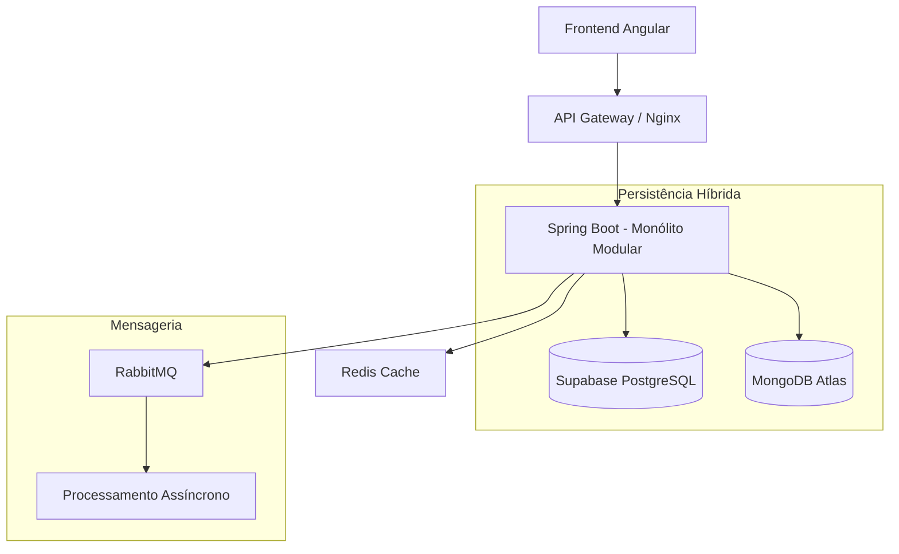

# Fabrica de IA Autonoma - Relatorio Final

**Ideia:** Sistema de Gestão Hospitalar Pública (HIS)

## scrum_master

_Modelo: gemini-3.1-flash-lite_

Como **Scrum Master**, analisei a arquitetura técnica e a especificação funcional do Sistema de Gestão Hospitalar (HIS). O objetivo da **Versão 0.1 (MVP)** é estabelecer a fundação de identidade, segurança e o fluxo clínico crítico (Urgência), garantindo que a base de auditoria e RBAC esteja operacional.

---

### Backlog da Versão 0.1 (MVP)

#### Sprint 1: Fundação e Segurança (Infraestrutura e RBAC)
*Foco: Estabelecer o ambiente, segurança e gestão de utilizadores.*

1. **US01 - Autenticação e RBAC:** Como administrador, quero gerir perfis de utilizadores para que cada profissional aceda apenas às funcionalidades do seu cargo.
   * **Prioridade:** Alta
   * **Critérios de Aceitação:**
     * Login com JWT e armazenamento de sessão no Redis.
     * Implementação de RBAC (Médico, Enfermeiro, Administrativo, Diretor).
     * Bloqueio de acesso a módulos não autorizados por perfil.
2. **US02 - Trilha de Auditoria (Audit Trail):** Como auditor, quero que todas as ações críticas sejam registadas para garantir a conformidade legal.
   * **Prioridade:** Alta
   * **Critérios de Aceitação:**
     * Interceptor que regista: `utilizador_id`, `ação`, `timestamp` e `ip` em tabela imutável.
     * Logs estruturados em JSON para integração com Prometheus/Grafana.

#### Sprint 2: Fluxo Clínico de Urgência (O Coração do Hospital)
*Foco: Admissão e Triagem de Manchester.*

3. **US03 - Admissão de Paciente:** Como rececionista, quero admitir pacientes para criar um episódio de urgência.
   * **Prioridade:** Alta
   * **Critérios de Aceitação:**
     * Registo de paciente com suporte a "Paciente Desconhecido" (ficha provisória).
     * Geração de número de episódio único.
4. **US04 - Triagem de Risco:** Como enfermeiro, quero classificar o risco do paciente para definir a prioridade de atendimento.
   * **Prioridade:** Alta
   * **Critérios de Aceitação:**
     * Registo de sinais vitais e queixa principal.
     * Aplicação da escala de Manchester (Cores: Vermelho, Laranja, Amarelo, Verde, Azul).
     * Atualização automática da fila de espera médica por prioridade.

#### Sprint 3: Atendimento Médico e Prescrição
*Foco: Prontuário e Segurança do Paciente.*

5. **US05 - Atendimento Médico:** Como médico, quero registar a evolução clínica e prescrever medicação.
   * **Prioridade:** Alta
   * **Critérios de Aceitação:**
     * Interface de prontuário com histórico do paciente.
     * Prescrição eletrónica com validação de campos obrigatórios.
     * Bloqueio de prescrição sem triagem prévia concluída.
6. **US06 - Administração de Medicação:** Como enfermeiro, quero administrar a medicação prescrita.
   * **Prioridade:** Alta
   * **Critérios de Aceitação:**
     * Visualização de prescrições ativas do turno.
     * Registo de administração com baixa automática no stock do setor.
     * Impedimento de administração sem prescrição médica válida.

---

### Planeamento de Sprints

| Sprint | Duração | Foco Principal |
| :--- | :--- | :--- |
| **Sprint 1** | 2 Semanas | Setup, Segurança (RBAC) e Auditoria |
| **Sprint 2** | 2 Semanas | Módulo de Urgência (Admissão e Triagem) |
| **Sprint 3** | 2 Semanas | Prontuário Médico e Ciclo de Medicação |

---

### Critérios de Aceitação Transversais (Definição de Pronto)
*   **Segurança:** Todos os endpoints devem validar o token JWT e o perfil (RBAC).
*   **Observabilidade:** Todos os erros devem gerar logs JSON com `correlation_id`.
*   **Consistência:** Operações de stock e estado clínico devem ser transacionais (ACID no PostgreSQL).
*   **Usabilidade:** Interfaces devem suportar atalhos de teclado para profissionais em urgência.
*   **Documentação:** Cada nova funcionalidade deve ter a sua trilha de auditoria testada.

**Nota:** A gestão de compras e BI (Apache Superset) será incluída na Versão 0.2, após a estabilização do fluxo assistencial clínico.

---

## arquiteto

_Modelo: gemini-3.1-flash-lite_

Como Arquiteto de Software, apresento a proposta de arquitetura para o Sistema de Gestão Hospitalar (HIS), focada em modularidade, integridade transacional e escalabilidade, seguindo rigorosamente as diretrizes estabelecidas.

---

### 1. Stack Tecnológica Recomendada
A stack foi escolhida pelo equilíbrio entre robustez corporativa e agilidade de desenvolvimento:

*   **Backend:** Java 21 + Spring Boot 3.x (Arquitetura de Monólito Modular).
*   **Frontend:** Angular 17+ (TypeScript) para interfaces de alta complexidade.
*   **Banco de Dados Relacional:** **Supabase (PostgreSQL)** para garantir ACID, integridade de prontuários e auditoria.
*   **Banco de Dados NoSQL/Logs:** **MongoDB Atlas** para logs de auditoria, sinais vitais em tempo real e documentos clínicos não estruturados.
*   **Cache/Mensageria:** Redis (sessões e cache de permissões) + RabbitMQ (eventos de domínio e integração assíncrona).
*   **Infraestrutura:** Docker + Kubernetes (K8s) para orquestração e alta disponibilidade.

---

### 2. Arquitetura em Camadas (Modular Monolith)
A estrutura organiza-se para permitir que módulos sejam extraídos como microsserviços no futuro, sem reescrita da lógica de negócio.

#### A. Camada de Apresentação (Frontend)
*   **Componentes:** SPA (Single Page Application) com estados de UI baseados em permissões (RBAC).
*   **Comunicação:** API Gateway (Nginx) que roteia requisições para o backend, validando JWT.

#### B. Camada de Aplicação e Domínio (Backend)
*   **Bounded Contexts:** Módulos isolados (Urgência, Internamento, MDT, Administrativo, Governação).
*   **Máquinas de Estado:** Implementadas via Spring State Machine para garantir que um paciente só transite de `TRIAGEM` para `INTERNADO` se as regras de negócio forem cumpridas.
*   **Outbox Pattern:** Garante que eventos (ex: `AltaMedicaRegistada`) sejam persistidos no PostgreSQL e publicados no RabbitMQ atomicamente.

#### C. Camada de Persistência (Híbrida)
*   **PostgreSQL (Supabase):** Armazena dados críticos: Prontuários, Escalas, Movimentação de Stocks, Faturação e Gestão de Leitos.
*   **MongoDB Atlas:** Armazena dados de alta volatilidade e logs de auditoria (Audit Trail), permitindo consultas flexíveis sobre o histórico de acessos e sinais vitais.

---

### 3. Limites e Regras de Segurança (SoD)
Para garantir a conformidade hospitalar, aplicamos limites rígidos:

1.  **Segregação de Funções (SoD):** O sistema impede que o mesmo utilizador inicie e aprove o mesmo processo financeiro ou clínico através de *Interceptors* de autorização no Spring Security.
2.  **Trilha de Auditoria:** Cada operação de escrita (CRUD) dispara um evento para o MongoDB, registando o `correlation_id`, `utilizador_id`, `perfil` e `ip_origem`.
3.  **Break-the-Glass:** Endpoint protegido que, ao ser acionado em emergência, desativa temporariamente restrições de acesso, disparando um alerta imediato para a Auditoria Interna.

---

### 4. Diagrama de Fluxo de Dados (Resumo)



---

### 5. Verificação de Escalabilidade
*   **Horizontal:** O backend é *stateless*. Novas instâncias podem ser adicionadas no Kubernetes conforme a carga de utilizadores.
*   **Analítica:** O Apache Superset conecta-se a uma **Réplica de Leitura** do PostgreSQL, garantindo que relatórios gerenciais não degradem a performance do atendimento clínico.
*   **Manutenção:** O uso de logs estruturados (JSON) centralizados permite a observabilidade proativa via stack Prometheus + Grafana.

---

## programador

_Modelo: gemini-3.1-flash-lite_

Este plano de implementação organiza o desenvolvimento do Sistema de Gestão Hospitalar (HIS) numa abordagem de **Monólito Modular**, garantindo a conformidade com as regras de negócio e os padrões de segurança exigidos.

---

### 1. Estrutura de Diretórios (Modular Monolith)
A estrutura reflete os domínios de negócio para facilitar a futura extração para microsserviços.

```text
/src
  /modules
    /urgencia        # Fluxos de triagem e atendimento agudo
    /internamento    # Gestão de leitos, cirurgia e enfermaria
    /mdt             # Laboratório, Imagiologia e Farmácia
    /administrativo  # RH, Finanças, Compras e Logística
    /governacao      # Auditoria, Pareceres e Dashboards
  /shared
    /infrastructure  # PostgreSQL, Redis, RabbitMQ, Logger (JSON)
    /security        # RBAC/ABAC, JWT, Audit Trail Interceptor
    /utils           # Máquinas de estado e validadores
```

---

### 2. Plano de Implementação (Fases)

#### Fase 1: Fundação e Segurança (Semanas 1-4)
*   **Setup:** Docker Compose com PostgreSQL (ACID) e Redis (Sessões/Cache).
*   **Segurança:** Implementação do middleware de RBAC/ABAC e o `Audit Trail` (interceptador global que regista todas as mudanças de estado).
*   **Core:** Definição das tabelas de `Utilizadores`, `UnidadesOrganizacionais` e `Perfis`.

#### Fase 2: Ciclo Assistencial (Semanas 5-10)
*   **Urgência:** Implementação da Máquina de Estado do Paciente (`ADMITIDO` -> `TRIAGEM` -> `ATENDIMENTO`).
*   **Internamento:** Gestão de leitos (bloqueio de alocação em leitos "sujos") e integração com o módulo de enfermagem.
*   **MDT:** Fluxo de pedidos de exames e dispensação farmacêutica (bloqueio de dispensação sem prescrição médica).

#### Fase 3: Ciclo de Suporte e Governação (Semanas 11-16)
*   **Logística:** Workflow de requisição interna de materiais com validação de stock.
*   **Financeiro:** Implementação das alçadas de aprovação (Regra de Segregação de Funções - SoD).
*   **BI:** Configuração da réplica de leitura para o Apache Superset.

---

### 3. Responsabilidades por Módulo

| Módulo | Responsabilidade Técnica | Regra Crítica |
| :--- | :--- | :--- |
| **Segurança** | Gestão de tokens e logs de auditoria imutáveis. | `Break-the-Glass` (alerta imediato à Auditoria). |
| **Urgência** | Gestão de filas e prioridade (Manchester). | Triagem obrigatória antes do médico. |
| **Internamento** | Gestão de estados de leito e prescrição. | Validade de 24h para prescrições médicas. |
| **Administrativo** | Workflow de compras e aprovações. | SoD (Quem solicita não aprova). |

---

### 4. Riscos Técnicos e Mitigação

1.  **Concorrência na Alocação de Leitos:**
    *   *Risco:* Dois enfermeiros alocarem o mesmo leito simultaneamente.
    *   *Mitigação:* Uso de transações `SELECT FOR UPDATE` no PostgreSQL para garantir consistência ACID.
2.  **Performance em Consultas de Auditoria:**
    *   *Risco:* Tabelas de logs crescerem exponencialmente.
    *   *Mitigação:* Implementar **particionamento de tabelas** por data no PostgreSQL e arquivamento em cold storage.
3.  **Falha na Comunicação Assíncrona:**
    *   *Risco:* Perda de eventos entre módulos (ex: Alta Médica não disparar limpeza).
    *   *Mitigação:* Utilizar o padrão **Transactional Outbox** para garantir que o evento só é enviado ao RabbitMQ se a transação no banco for confirmada.
4.  **Complexidade de Regras de Negócio (RBAC):**
    *   *Risco:* Acesso indevido a dados clínicos sensíveis.
    *   *Mitigação:* Auditoria centralizada que regista o `ID_Utilizador` e `IP` em cada acesso a prontuários.

---

### 5. Checklist de Verificação (Definition of Done)
*   [ ] **Audit Trail:** Cada alteração de estado gera uma entrada na tabela de auditoria.
*   [ ] **SoD:** O sistema impede que o mesmo utilizador inicie e aprove um pedido de compra.
*   [ ] **Observabilidade:** Logs em formato JSON com `correlation_id` implementados em todas as rotas.
*   [ ] **Healthchecks:** Endpoints de monitorização configurados para o Prometheus.
*   [ ] **Segurança:** RBAC validado para todos os perfis (Direção, Médicos, Enfermeiros, Administrativos).

---

## qa

_Modelo: gemini-3.1-flash-lite_

Como responsável pela Garantia de Qualidade (QA), apresento o plano de testes estruturado para o Sistema de Gestão Hospitalar (HIS), focado na integridade, conformidade e segurança exigidas pelo contexto hospitalar.

---

### 1. Plano de Testes Unitários (Backend - Spring Boot / NestJS)
**Objetivo:** Validar a lógica de negócio isolada (serviços e máquinas de estado).

*   **Comandos de Execução:**
    *   `mvn test` (Java) ou `npm run test` (Node.js).
*   **Escopo:**
    *   **Máquinas de Estado:** Testar transições proibidas (ex: tentar dar `ALTA_MEDICA` em paciente com estado `AGUARDANDO_TRIAGEM`).
    *   **Regras de Negócio:** Validar cálculos de prioridade (Triagem de Manchester) e validação de alçadas financeiras.
    *   **RBAC/ABAC:** Testar se métodos protegidos rejeitam utilizadores sem a permissão necessária.
*   **Critério de Conclusão:** 100% de cobertura nos serviços críticos (Core Clínico e Financeiro) e ausência de falhas em testes de lógica pura.

---

### 2. Plano de Testes de Integração
**Objetivo:** Validar a comunicação entre módulos, persistência e mensageria.

*   **Comandos de Execução:**
    *   `mvn verify` (com perfis de integração) ou `npm run test:e2e`.
*   **Escopo:**
    *   **Persistência (PostgreSQL):** Testar transações ACID em alocação de leitos (evitar *race conditions* na ocupação de camas).
    *   **Mensageria (RabbitMQ/Kafka):** Validar se o evento `AltaMedicaRegistada` dispara corretamente as tarefas de `HigienizacaoLeito`.
    *   **Auditoria:** Verificar se cada ação de escrita gera um registo imutável na tabela de `Audit Trail`.
*   **Critério de Conclusão:** Sucesso na comunicação entre módulos (ex: Farmácia recebe notificação de baixa de stock após prescrição médica confirmada).

---

### 3. Plano de Testes de Aceitação (Scrum Master / UAT)
**Objetivo:** Validar se o sistema cumpre os critérios de negócio definidos nas especificações.

*   **Comandos de Execução:**
    *   Execução manual de fluxos (Checklist de Jornada) ou via ferramentas de BDD (Cucumber/Gherkin).
*   **Escopo (Cenários Críticos):**
    *   **Cenário 1 (Break-the-Glass):** Médico acede a prontuário restrito em emergência; validar se o sistema bloqueia e gera alerta de auditoria.
    *   **Cenário 2 (Segregação de Funções):** Tentar aprovar um pagamento onde o utilizador é o mesmo que solicitou a compra; o sistema deve bloquear.
    *   **Cenário 3 (Fluxo de Alta):** Validar se o sistema impede a alta administrativa sem a prévia alta médica.
*   **Critério de Conclusão:** Aprovação formal do Scrum Master em todos os fluxos de jornada do paciente e fluxos financeiros.

---

### 4. Critérios de Qualidade e Reporte de Bugs
Para que qualquer funcionalidade seja considerada "Pronta para Produção", deve cumprir:

1.  **Zero Bugs Críticos/Bloqueantes:** Nenhum erro que impeça o atendimento clínico ou a integridade financeira.
2.  **Auditabilidade:** Todos os logs gerados durante os testes devem estar em formato JSON e conter o `correlation_id`.
3.  **Performance:** Latência de resposta para prescrições e triagem deve ser inferior a 200ms (conforme diretrizes de usabilidade clínica).

**Procedimento de Reporte:**
*   Todo bug detetado deve ser registado no sistema de gestão de tarefas (ex: Jira/GitHub Issues) contendo:
    *   `Passos para reproduzir`
    *   `Resultado esperado vs. Resultado obtido`
    *   `Severidade (Crítico, Alto, Médio, Baixo)`
    *   `Evidência (Log ou Screenshot)`

---
*Nota: Este plano será aplicado a cada sprint de desenvolvimento para garantir a estabilidade do HIS.*

---
