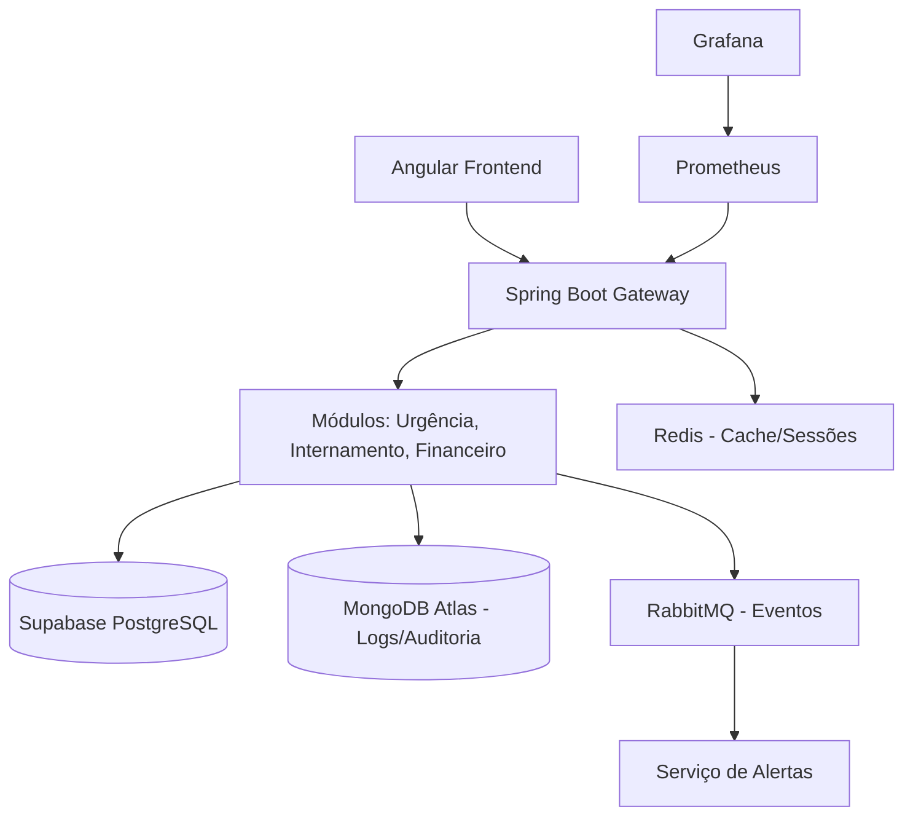

# Fabrica de IA Autonoma - Relatorio Final

**Ideia:** Sistema de Gestão Hospitalar Pública (HIS)

## scrum_master

_Modelo: gemini-3.1-flash-lite_

Como Scrum Master, apresento o Backlog da **Versão 0.1 (MVP - Fundação Operacional)** do Sistema de Gestão Hospitalar (HIS). O foco desta sprint é estabelecer a espinha dorsal de segurança, autenticação e a jornada básica do paciente na Urgência.

---

### Sprint 1: Fundação, Segurança e Urgência Básica
**Objetivo:** Garantir que o sistema é seguro, auditável e capaz de admitir e triar um paciente na Urgência.

#### Histórias de Utilizador (User Stories)

**US01: Autenticação e RBAC (Segurança)**
*   **Prioridade:** Crítica
*   **Descrição:** Como utilizador, quero autenticar-me no sistema para aceder apenas às funcionalidades permitidas pelo meu perfil.
*   **Critérios de Aceitação:**
    *   Login com encriptação de credenciais.
    *   O sistema bloqueia acesso a módulos não autorizados (ex: Rececionista não acede a prontuário médico).
    *   Registo de `login_sucesso` e `login_falhado` na trilha de auditoria.

**US02: Admissão de Paciente na Urgência**
*   **Prioridade:** Alta
*   **Descrição:** Como rececionista, quero admitir um paciente (identificado ou desconhecido) para abrir um episódio de urgência.
*   **Critérios de Aceitação:**
    *   Criação de ficha provisória para pacientes indocumentados.
    *   Geração de `ID_Episodio` único.
    *   O estado inicial do episódio deve ser `ADMITIDO`.

**US03: Triagem de Risco (Manchester)**
*   **Prioridade:** Alta
*   **Descrição:** Como enfermeiro, quero registar sinais vitais e classificar o risco do paciente para definir a prioridade de atendimento.
*   **Critérios de Aceitação:**
    *   Formulário de sinais vitais (PA, FC, Temp, SatO2).
    *   Seleção de cor de prioridade (Triagem de Manchester).
    *   Mudança automática de estado do episódio para `AGUARDANDO_MEDICO`.

**US04: Trilha de Auditoria (Audit Trail)**
*   **Prioridade:** Crítica
*   **Descrição:** Como auditor, quero que todas as ações críticas sejam registadas imutavelmente.
*   **Critérios de Aceitação:**
    *   Captura automática de `utilizador_id`, `timestamp`, `acao` e `ip_origem` em cada transação de estado.
    *   Logs estruturados em formato JSON.

---

### Sprint 2: Atendimento Clínico e Suporte
**Objetivo:** Permitir que o médico prescreva e que a farmácia/enfermagem interaja com o plano de cuidados.

#### Histórias de Utilizador (User Stories)

**US05: Prescrição Médica**
*   **Prioridade:** Alta
*   **Descrição:** Como médico, quero prescrever medicamentos e solicitar exames para o paciente em atendimento.
*   **Critérios de Aceitação:**
    *   Validação de prescrição: O sistema não permite prescrição sem episódio ativo.
    *   Assinatura digital do médico no registo da prescrição.

**US06: Administração de Medicação (Check-list)**
*   **Prioridade:** Alta
*   **Descrição:** Como enfermeiro, quero visualizar a prescrição médica e registar a administração do fármaco.
*   **Critérios de Aceitação:**
    *   Bloqueio de administração se não houver prescrição válida.
    *   Registo de hora de administração e identificação do enfermeiro.

**US07: Gestão de Leitos (Urgência/Observação)**
*   **Prioridade:** Média
*   **Descrição:** Como enfermeiro-chefe, quero alterar o estado de um leito (Livre, Ocupado, Higienização).
*   **Critérios de Aceitação:**
    *   Impedir alocação de paciente em leito com estado `AGUARDANDO_HIGIENIZACAO`.
    *   Disparo de alerta para equipa de limpeza ao marcar leito como `ALTA_MEDICA`.

---

### Resumo de Planeamento (Backlog V0.1)

| Sprint | Foco | Principais Entregas |
| :--- | :--- | :--- |
| **S1** | Infraestrutura e Triagem | Auth, RBAC, Admissão, Triagem, Audit Trail |
| **S2** | Assistência Clínica | Prescrição, Administração, Gestão de Leitos |

**Notas do Scrum Master:**
1.  **Critérios de Aceitação:** Todos os critérios acima devem ser testados via testes de integração (Spring Boot/JUnit) e testes de interface (Angular/Cypress).
2.  **Comunicação:** As equipas de Backend (Java) e Frontend (Angular) devem alinhar os contratos de API (Swagger/OpenAPI) antes de iniciar cada sprint para garantir a fluidez da comunicação.
3.  **Qualidade:** A trilha de auditoria é um requisito não-funcional que deve ser implementado via *Aspect-Oriented Programming (AOP)* no Spring para garantir que nenhum dado clínico seja alterado sem registo.

---

## arquiteto

_Modelo: gemini-3.1-flash-lite_

Como Arquiteto de Software, apresento a proposta de arquitetura para o Sistema de Gestão Hospitalar (HIS), focada em modularidade, integridade transacional e escalabilidade, seguindo rigorosamente a stack recomendada.

---

### 1. Stack Tecnológica (Proporcional e Robusta)

Para garantir a manutenção preventiva e a análise crítica exigidas, a stack escolhida prioriza a consistência de dados e a facilidade de manutenção:

*   **Backend:** **Java 21 + Spring Boot** (Arquitetura de Monólito Modular).
*   **Frontend:** **Angular** (TypeScript) para interfaces complexas e formulários reativos.
*   **Banco de Dados Relacional (Core):** **Supabase (PostgreSQL)** para garantir ACID, integridade de prontuários e auditoria.
*   **Banco de Dados NoSQL/Logs:** **MongoDB Atlas** para logs de auditoria, logs de sistema e dados não estruturados (ex: telemetria de equipamentos).
*   **Cache/Filas:** **Redis** (sessões e painéis de triagem) + **RabbitMQ** (mensageria entre módulos).
*   **Observabilidade:** **Prometheus + Grafana**.

---

### 2. Arquitetura em Camadas (Modular Monolith)

A estrutura é desenhada para permitir que domínios (Bounded Contexts) evoluam sem acoplamento excessivo.

#### A. Camada de Apresentação (Frontend)
*   **SPA (Single Page Application):** Angular com *Lazy Loading* por módulo (Urgência, Internamento, Administrativo).
*   **Segurança:** Autenticação via JWT com RBAC/ABAC integrado ao Spring Security.

#### B. Camada de Aplicação (Backend - Spring Boot)
*   **Módulos de Domínio:** Cada módulo (Urgência, MDT, RH, Financeiro) possui o seu próprio pacote, isolando regras de negócio.
*   **State Machines:** Implementadas para gerir fluxos clínicos (ex: `Triagem` -> `Internamento` -> `Alta`).
*   **Event-Driven:** Uso de *Application Events* (internos) e *RabbitMQ* (para comunicação entre serviços ou integração com sistemas externos/HL7).

#### C. Camada de Persistência (Híbrida)
*   **PostgreSQL (Supabase):** Armazena dados transacionais críticos: Prontuários, Escalas, Movimentação de Stock, Faturas e Dados de Pacientes.
*   **MongoDB Atlas:** Armazena logs de auditoria imutáveis, logs de erro e telemetria de dispositivos médicos.

---

### 3. Limites e Regras de Integração

Para garantir a integridade e a segregação de funções (SoD), definimos os seguintes limites:

1.  **Isolamento de Domínio:** Um módulo nunca acede diretamente à base de dados de outro. A comunicação é feita via **Eventos** (ex: `AltaMedicaRegistada` dispara o evento de `HigienizacaoLeito`).
2.  **Trilha de Auditoria (Audit Trail):** Qualquer alteração em dados críticos (prescrições, movimentos financeiros) é interceptada por um *Aspect* (AOP) no Spring e persistida no **MongoDB** com o contexto completo (`user_id`, `timestamp`, `ip`, `payload_antes`, `payload_depois`).
3.  **Segregação de Leitura/Escrita:** Consultas pesadas para BI (Apache Superset) são direcionadas para uma réplica de leitura do PostgreSQL, evitando impacto na performance do atendimento clínico.

---

### 4. Diagrama de Fluxo de Dados (Conceitual)



---

### 5. Verificação de Conformidade
*   **Escalabilidade:** O backend é *stateless*, permitindo o escalamento horizontal de instâncias.
*   **Segurança:** RBAC/ABAC implementado na camada de serviço, validando permissões antes de qualquer transação.
*   **Manutenção:** A arquitetura modular permite que, se o módulo de "Urgência" crescer excessivamente, ele possa ser extraído para um microsserviço independente sem alterar a estrutura base do monólito.

---

## programador

_Modelo: gemini-3.1-flash-lite_

Este plano de implementação organiza o desenvolvimento do Sistema de Gestão Hospitalar (HIS) em fases lógicas, respeitando a arquitetura de **Monólito Modular** e as regras de **RBAC/Auditoria** definidas.

---

### 1. Estrutura de Diretórios (Modular Monolith)
A estrutura deve garantir o desacoplamento por domínios (`Bounded Contexts`):

```text
/src
  /modules
    /urgencia
    /ambulatorio
    /internamento
    /mdt (Laboratório, Farmácia, Imagiologia)
    /administrativo (RH, Finanças, Compras)
    /governacao (Auditoria, Ética)
  /shared
    /database (Configuração PostgreSQL/TypeORM/Prisma)
    /messaging (RabbitMQ/Outbox)
    /auth (RBAC/JWT/Middleware)
    /audit (Interceptors de Auditoria)
  /config
  /tests
```

---

### 2. Plano de Implementação (Fases)

#### Fase 1: Fundação e Segurança (Sprint 1-2)
*   **Objetivo:** Configurar o ambiente, autenticação e trilha de auditoria.
*   **Entregáveis:**
    *   Setup do projeto (NestJS/TypeScript ou Spring Boot).
    *   Implementação do Middleware de **RBAC** (controlo de acesso baseado em perfis).
    *   Criação do **Audit Interceptor**: Serviço que intercepta todas as operações de escrita e persiste no log de auditoria (tabela `audit_logs`).
    *   Configuração do PostgreSQL com suporte a JSONB para formulários dinâmicos.

#### Fase 2: Ciclo Assistencial (Sprint 3-6)
*   **Objetivo:** Implementar o core clínico (Urgência e Internamento).
*   **Entregáveis:**
    *   **Máquina de Estados:** Implementação dos fluxos de `Paciente` (Triagem -> Atendimento -> Alta).
    *   **Prontuário Eletrónico:** Módulo de prescrição médica com validação de interação medicamentosa.
    *   **Gestão de Leitos:** Módulo de ocupação e higienização (bloqueio de alocação se `status != 'LIVRE'`).

#### Fase 3: Ciclo de Suporte e Logística (Sprint 7-9)
*   **Objetivo:** Gestão de recursos e aprovações financeiras.
*   **Entregáveis:**
    *   **Workflow de Compras:** Implementação do padrão *Outbox* para garantir que a baixa de stock e o pedido de compra sejam atómicos.
    *   **Alçadas de Aprovação:** Lógica de negócio para validar se o utilizador possui permissão para aprovar despesas (baseado na hierarquia do documento de requisitos).

#### Fase 4: Observabilidade e BI (Sprint 10+)
*   **Objetivo:** Monitorização e relatórios.
*   **Entregáveis:**
    *   Integração com **Prometheus/Grafana** para métricas de latência e erros.
    *   Criação de `Data Mart` (réplica de leitura) para o **Apache Superset**.

---

### 3. Responsabilidades por Módulo

| Módulo | Responsabilidade Técnica |
| :--- | :--- |
| **Auth/RBAC** | Garantir que o `Diretor Geral` não acede a prontuários clínicos. |
| **Auditoria** | Garantir a imutabilidade dos logs (escrita em tabela *append-only*). |
| **Core Clínico** | Implementar a lógica de "Break-the-Glass" (acesso de emergência com log de alerta). |
| **Logística** | Segregação de funções (SoD): quem solicita não aprova. |

---

### 4. Riscos Técnicos e Mitigação

1.  **Concorrência na Alocação de Leitos:**
    *   *Risco:* Dois enfermeiros alocarem o mesmo leito simultaneamente.
    *   *Mitigação:* Utilizar **Locking Otimista** no PostgreSQL ou transações com isolamento `SERIALIZABLE` na tabela de leitos.
2.  **Performance em Consultas de Auditoria:**
    *   *Risco:* A tabela de auditoria crescer exponencialmente e degradar o sistema.
    *   *Mitigação:* Implementar **particionamento de tabelas** por data (ex: mensal) no PostgreSQL.
3.  **Consistência em Operações Distribuídas:**
    *   *Risco:* Falha na comunicação entre o módulo de Farmácia e o módulo de Internamento.
    *   *Mitigação:* Utilizar o padrão **Transactional Outbox** para garantir que a mensagem de "Baixa de Medicamento" seja enviada ao RabbitMQ apenas se a transação local for confirmada.
4.  **Complexidade do RBAC:**
    *   *Risco:* Permissões excessivamente granulares tornarem o código difícil de manter.
    *   *Mitigação:* Utilizar **ABAC (Attribute-Based Access Control)** em conjunto com RBAC, permitindo definir permissões baseadas no contexto (ex: "Médico só pode editar prontuário se for o médico assistente do paciente").

---

### 5. Verificação de Qualidade
*   **Testes Unitários:** Foco estrito na lógica das Máquinas de Estado.
*   **Testes de Integração:** Validar o fluxo de aprovação de compras (o processo deve falhar se não houver parecer jurídico em compras de alto valor).
*   **Análise Estática:** Uso de *SonarQube* para garantir que não há violações de segurança no código.

---

## qa

_Modelo: gemini-3.5-flash-lite_

# Plano de Qualidade e Testes — Sistema de Gestão Hospitalar Pública (HIS)

Este plano define a estratégia de testes unitários, de integração e de aceitação, garantindo a conformidade com as regras de negócio, a integridade transacional (ACID), a segurança (RBAC/ABAC) e a trilha de auditoria (Audit Trail) do HIS.

---

## 1. Testes Unitários (Unit Testing)

Objetivo: Validar componentes isolados, regras de negócio puras, máquinas de estado clínico e cálculos de alocação no backend (Java/Spring Boot) e frontend (Angular/React).

### Comandos de Execução
* **Backend (Java / Maven):**
  ```bash
  mvn clean test
  ```
* **Frontend (Angular / Jest ou Karma):**
  ```bash
  npm run test -- --watch=false
  ```

### Critérios de Conclusão e Casos Críticos
* **Máquinas de Estado:** Validar transições estritas (ex: `AGUARDANDO_TRIAGEM` $\rightarrow$ `EM_ATENDIMENTO` $\rightarrow$ `ALTA_MEDICA`). Tentativas de transições inválidas (ex: `ALTA_MEDICA` direto para `AGUARDANDO_TRIAGEM`) devem lançar exceções tratadas.
* **Segregação de Funções (SoD):** Validar que regras unitárias de validação de papéis impedem ações cruzadas (ex: um perfil de Enfermagem a tentar emitir uma alta médica).
* **Cobertura Mínima:** Pelo menos 80% de cobertura de código em domínios críticos (Prescrições, Triagem, Alocação de Leitos).

---

## 2. Testes de Integração (Integration Testing)

Objetivo: Validar a comunicação entre módulos, persistência relacional (PostgreSQL), mensageria assíncrona (RabbitMQ/Outbox) e cache (Redis).

### Comandos de Execução
* **Execução de Testes de Integração com Testcontainers:**
  ```bash
  mvn verify -Dtest=*IntegrationTest
  ```

### Critérios de Conclusão e Casos Críticos
* **Transacionalidade (ACID):** Validar que a alocação de leitos e a baixa simultânea de stock em farmácia ocorrem numa única transação atômica (Rollback em caso de falha de stock).
* **Trilha de Auditoria Imutável (Audit Trail):** Testar se qualquer alteração em prontuários ou ordens de compra gera automaticamente o registo com `utilizador_id`, `perfil_ativo`, `dados_anteriores`, `dados_novos` e `ip_origem`.
* **Mensageria (Event-Driven):** Validar que o evento `AltaMedicaRegistada` dispara assincronamente a notificação para o módulo de `HigienizacaoLeito` (estado do leito alterado para `AGUARDANDO_HIGIENIZACAO`).

---

## 3. Testes de Aceitação e Critérios do Scrum Master (Acceptance Testing)

Objetivo: Validar se as entregas funcionais cumprem rigorosamente os critérios de aceitação definidos para o fluxo hospitalar público e as restrições RBAC/ABAC.

### Casos de Teste de Aceitação Funcional

1. **Jornada de Urgência / Triagem:**
   * *Critério:* Permitir abertura de ficha provisória ("Paciente Indocumentado") em casos críticos.
   * *Verificação:* O sistema cria o episódio sem bloquear por falta de número de identificação, gerando alerta para identificação posterior.

2. **Fluxo de Prescrição e Administração:**
   * *Critério:* O enfermeiro não pode administrar medicação sem prescrição médica ativa.
   * *Verificação:* Tentativa de registo de administração na folha de enfermagem sem receita associada deve ser rejeitada pela interface e API.

3. **Contingência "Break-the-Glass":**
   * *Critério:* Acesso excecional a histórico clínico restrito em risco de morte.
   * *Verificação:* O médico insere justificativa obrigatória; o acesso é concedido e gera automaticamente um alerta de auditoria para a Comissão de Ética e Auditoria Interna.

4. **Workflow de Compras de Alto Valor (Alçada 2):**
   * *Critério:* Compras acima do limite de alçada exigem parecer jurídico e da auditoria antes da assinatura da Direção Geral.
   * *Verificação:* O sistema bloqueia a aprovação final se os pareceres obrigatórios não estiverem anexados e validados por assinatura digital.

### Critérios de Conclusão Global para Produção
* **Zero Bugs Críticos ou Bloqueantes** pendentes nos módulos assistenciais (Urgência, Internamento, Farmácia).
* **Validação de Segurança:** Aprovação em testes de permissão RBAC (nenhum perfil executa ações fora da sua matriz autorizada).
* **Relatório de QA:** Emissão do parecer técnico de qualidade assinado antes do envio para o ambiente de produção.

---
