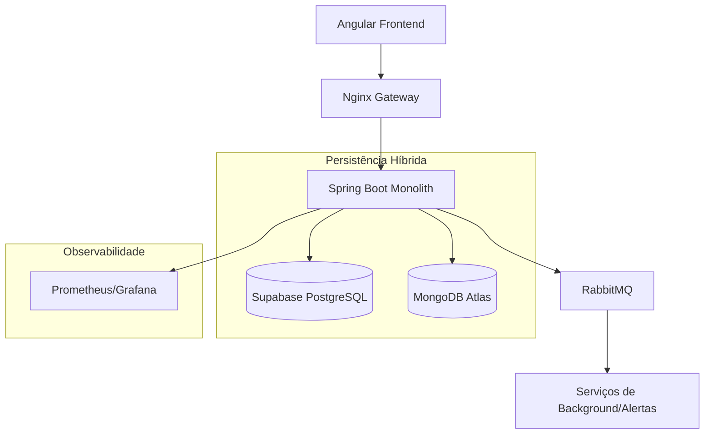

# Fabrica de IA Autonoma - Relatorio Final

**Ideia:** Sistema de Gestão Hospitalar Pública (HIS)

## scrum_master

_Modelo: gemini-3.1-flash-lite_

Como Scrum Master, apresento o Backlog da **Versão 0.1 (MVP - Mínimo Produto Viável)** para o Sistema de Gestão Hospitalar (HIS). O foco desta versão é estabelecer a fundação de segurança (RBAC), a jornada clínica básica na Urgência e a gestão de ativos essenciais.

---

### Sprint 1: Fundação, Segurança e Infraestrutura
*Objetivo: Estabelecer a base tecnológica, autenticação e o modelo de dados central.*

1. **US01 - Autenticação e RBAC (Controlo de Acesso)**
   - **Prioridade:** Alta
   - **Critérios de Aceitação:**
     - Utilizador autentica-se com credenciais únicas.
     - O sistema bloqueia o acesso a módulos baseados no perfil (Médico, Enfermeiro, Administrativo).
     - Logs de acesso registam tentativa de login e perfil ativo.

2. **US02 - Registo de Paciente (Admissão)**
   - **Prioridade:** Alta
   - **Critérios de Aceitação:**
     - Criar ficha de paciente com dados básicos.
     - Permitir registo de "Paciente Desconhecido" para casos de emergência.
     - Gerar ID único de paciente (UUID).

---

### Sprint 2: Jornada Clínica na Urgência
*Objetivo: Implementar o fluxo de atendimento de emergência, desde a triagem até ao desfecho.*

3. **US03 - Triagem de Manchester**
   - **Prioridade:** Alta
   - **Critérios de Aceitação:**
     - Enfermeiro regista sinais vitais e queixa principal.
     - Sistema atribui cor de risco automaticamente.
     - Fila de espera médica ordenada por prioridade (cor).

4. **US04 - Prontuário Médico (Atendimento)**
   - **Prioridade:** Alta
   - **Critérios de Aceitação:**
     - Médico visualiza histórico de triagem.
     - Médico regista anamnese e hipótese diagnóstica.
     - Médico emite prescrição de medicação (com validação de dose).

---

### Sprint 3: Gestão de Recursos e Logística Básica
*Objetivo: Garantir que o médico tem o que prescrever e que o hospital gere o seu inventário.*

5. **US05 - Gestão de Stock e Farmácia**
   - **Prioridade:** Média
   - **Critérios de Aceitação:**
     - Baixa automática no stock após administração de medicamento.
     - Alerta de rutura de stock para itens críticos (ex: antibióticos de urgência).
     - Segregação de funções: Médico prescreve, Farmacêutico/Enfermeiro dispensa.

6. **US06 - Gestão de Leitos e Higienização**
   - **Prioridade:** Média
   - **Critérios de Aceitação:**
     - Visualização de mapa de leitos (Livre, Ocupado, Higienização).
     - Gatilho automático: Alta Médica dispara tarefa de higienização para Serviços Gerais.
     - Bloqueio de alocação de leito "Sujo".

---

### Sprint 4: Auditoria e Observabilidade
*Objetivo: Garantir a conformidade legal e a saúde do sistema.*

7. **US07 - Trilha de Auditoria (Audit Trail)**
   - **Prioridade:** Alta
   - **Critérios de Aceitação:**
     - Cada alteração em prontuário ou movimento financeiro regista: `User_ID`, `Timestamp`, `Ação`, `Valor_Anterior`, `Valor_Novo`.
     - Logs imutáveis acessíveis apenas por perfil de Auditoria.

8. **US08 - Monitorização de Saúde do Sistema**
   - **Prioridade:** Média
   - **Critérios de Aceitação:**
     - Dashboard no Grafana com latência de API e uso de recursos.
     - Alerta por e-mail/Slack se o serviço de mensageria (RabbitMQ) estiver inativo.

---

### Resumo do Planeamento de Sprints

| Sprint | Foco Principal | Entregáveis Chave |
| :--- | :--- | :--- |
| **S1** | Infraestrutura | RBAC, Autenticação, Cadastro de Pacientes |
| **S2** | Core Clínico | Triagem, Prontuário, Prescrição |
| **S3** | Operações | Gestão de Stock, Gestão de Leitos |
| **S4** | Governação | Auditoria, Monitorização, Estabilização |

**Nota do Scrum Master:** Os critérios de aceitação foram desenhados para serem testáveis via testes de integração (Spring Boot/JUnit) e testes de aceitação de utilizador (UAT) com as equipas de enfermagem e medicina. A **Segregação de Funções (SoD)** será validada em cada sprint como requisito não-funcional obrigatório.

---

## arquiteto

_Modelo: gemini-3.1-flash-lite_

Como Arquiteto de Software, apresento a proposta de arquitetura para o Sistema de Gestão Hospitalar (HIS), focada em modularidade, integridade transacional e escalabilidade, seguindo rigorosamente a stack recomendada.

---

### 1. Stack Tecnológica (Proporcional e Robusta)

Para garantir a manutenção preventiva e a análise crítica exigidas, a stack escolhida prioriza a consistência de dados e a facilidade de manutenção:

*   **Backend:** **Java 21 + Spring Boot 3.x**. Escolhido pela robustez em transações ACID, suporte nativo a máquinas de estado e facilidade na implementação de trilhas de auditoria (Spring Data Envers).
*   **Frontend:** **Angular 17+**. Ideal para formulários complexos, tipagem forte e gestão de estado em sistemas corporativos de grande escala.
*   **Banco de Dados Relacional (Core):** **Supabase (PostgreSQL)**. Essencial para a integridade dos dados clínicos e financeiros. Utilizaremos *Row Level Security* (RLS) para garantir que apenas utilizadores autorizados acedam a dados sensíveis.
*   **Banco de Dados NoSQL/Logs:** **MongoDB Atlas**. Utilizado para armazenar logs de auditoria imutáveis, telemetria de equipamentos médicos e documentos clínicos não estruturados (JSONB).
*   **Cache e Mensageria:** **Redis** (sessões e rate limiting) e **RabbitMQ** (comunicação assíncrona entre módulos e alertas críticos).

---

### 2. Arquitetura em Camadas (Modular Monolith)

A arquitetura será organizada em **Bounded Contexts** (Módulos) dentro do mesmo deploy, permitindo o desacoplamento lógico e a futura extração para microsserviços.

#### A. Camada de Apresentação (Frontend)
*   **SPA (Single Page Application):** Angular com *Lazy Loading* por módulo (ex.: Módulo de Urgência, Módulo de Internamento).
*   **Comunicação:** API Gateway (Nginx) para roteamento e autenticação via JWT.

#### B. Camada de Aplicação (Backend - Spring Boot)
*   **Interface de Domínio:** Controladores REST organizados por contexto.
*   **Service Layer:** Onde residem as **Máquinas de Estado** (ex.: `FluxoInternamentoService`).
*   **Event Bus:** Disparo de eventos de domínio (ex.: `AltaMedicaRegistada`) via RabbitMQ para notificar outros módulos sem acoplamento direto.

#### C. Camada de Persistência (Híbrida)
*   **PostgreSQL (Supabase):** Tabelas transacionais (Pacientes, Prescrições, Escalas, Financeiro).
*   **MongoDB:** Coleções de auditoria (`AuditTrail`), logs de erros e telemetria de sensores hospitalares.

---

### 3. Limites e Regras de Segurança (RBAC/ABAC)

Para garantir a conformidade com o organograma hospitalar, aplicaremos:

1.  **Segregação de Funções (SoD):** A camada de serviço valida se o utilizador possui o *claim* necessário antes de executar transações críticas (ex.: apenas `Diretor_Financeiro` pode aprovar empenhos).
2.  **Trilha de Auditoria:** Interceptor global no Spring Boot que captura o contexto do utilizador e persiste a alteração no MongoDB antes de confirmar a transação no PostgreSQL.
3.  **Break-the-Glass:** Endpoint de emergência que, ao ser acionado, eleva o nível de acesso temporariamente, disparando um evento de auditoria prioritário para a `Comissão de Ética`.

---

### 4. Diagrama de Fluxo de Dados (Resumo)



---

### 5. Considerações de Escalabilidade
*   **Stateless:** A aplicação não armazena estado de sessão local; toda a autenticação é validada via JWT + Redis.
*   **Leitura Analítica:** Consultas pesadas de BI são direcionadas para uma **Réplica de Leitura** do PostgreSQL, garantindo que o atendimento clínico (escrita) nunca sofra latência por relatórios gerenciais.
*   **Manutenção Preventiva:** Jobs agendados (Spring Batch) monitorizam diariamente a integridade dos dados e o estado de expiração de certificados e stocks críticos.

---

## programador

_Modelo: gemini-3.1-flash-lite_

Este plano de implementação organiza o desenvolvimento do Sistema de Gestão Hospitalar (HIS) numa abordagem de **Monólito Modular**, garantindo a conformidade com as regras de negócio e a segregação de funções (SoD) exigidas.

---

### 1. Estrutura de Diretórios (Modular Monolith)
A estrutura segue o padrão de domínios (Bounded Contexts) para garantir desacoplamento lógico:

```text
/src
  /modules
    /urgencia          # Triagem, Admissão, Fluxo de Paciente
    /internamento      # Gestão de Leitos, Prescrições, Bloco
    /mdt               # Laboratório, Imagiologia, Farmácia
    /administrativo    # RH, Compras, Finanças, Logística
    /governacao        # Auditoria, Pareceres Jurídicos, BI
  /shared
    /infrastructure    # Database, Redis, RabbitMQ, Logger
    /security          # RBAC/ABAC, JWT, Audit Trail
    /utils             # Validações, Máquinas de Estado
```

---

### 2. Fases de Implementação (Roadmap)

#### Fase 1: Fundação e Segurança (Semanas 1-4)
* **Objetivo:** Estabelecer o core de segurança e a trilha de auditoria.
* **Entregáveis:**
    * Configuração do PostgreSQL com particionamento (tabelas de auditoria).
    * Implementação do middleware de **RBAC/ABAC** (baseado na matriz de permissões).
    * Serviço de **Audit Trail** (interceptor global para registo de ações imutáveis).
* **Risco:** Falha na captura de logs de auditoria (Mitigação: Testes unitários de interceptores).

#### Fase 2: Ciclo Assistencial (Semanas 5-12)
* **Objetivo:** Implementar a jornada clínica (Urgência e Internamento).
* **Entregáveis:**
    * Máquinas de estado para `Episódio` e `Leito`.
    * Fluxo de Triagem (Manchester) e Prescrição Médica.
    * Integração com Redis para painéis de senhas em tempo real.
* **Risco:** Conflito de alocação de leitos (Mitigação: Bloqueios transacionais ACID no Postgres).

#### Fase 3: Ciclo de Suporte e Logística (Semanas 13-20)
* **Objetivo:** Gestão de recursos e workflow financeiro.
* **Entregáveis:**
    * Workflows de aprovação (Alçadas de aprovação para compras).
    * Integração com RabbitMQ para notificações de rutura de stock.
    * Módulo de RH (Escalas de turnos).
* **Risco:** Quebra na segregação de funções (Mitigação: Validação de SoD no nível da camada de serviço).

---

### 3. Responsabilidades por Módulo

| Módulo | Responsabilidade Técnica | Stack Principal |
| :--- | :--- | :--- |
| **Segurança** | Gestão de tokens, RBAC e logs de auditoria | Node.js / NestJS |
| **Clínico** | Máquinas de estado e prontuário eletrónico | Node.js / Fastify |
| **Logístico** | Gestão de stock e workflows de aprovação | Node.js / NestJS |
| **Governação** | Dashboards (BI) e relatórios de conformidade | Python / Pandas / Superset |

---

### 4. Riscos Técnicos e Mitigação

1. **Integridade de Dados (Transacional):**
   * *Risco:* Inconsistência entre stock de farmácia e prescrição médica.
   * *Mitigação:* Utilização de **Transactional Outbox Pattern** para garantir que a baixa de stock ocorra apenas se a prescrição for confirmada.

2. **Performance em Consultas Pesadas:**
   * *Risco:* Relatórios de BI degradando a performance do sistema transacional.
   * *Mitigação:* Implementação de **Read Replicas** no PostgreSQL e uso de Data Marts para consultas analíticas.

3. **Indisponibilidade Crítica:**
   * *Risco:* Falha no sistema durante atendimento de urgência.
   * *Mitigação:* Arquitetura Stateless, Load Balancer (Nginx) e monitoramento proativo (Prometheus/Grafana) com alertas de latência.

4. **Conformidade Legal (Auditoria):**
   * *Risco:* Alteração indevida de registos clínicos.
   * *Mitigação:* Tabelas de auditoria com `append-only` e assinatura digital (hash) de documentos clínicos (prontuários/receitas).

---

### 5. Checklist de Verificação (Definition of Done)
* [ ] O log de auditoria regista o `ID_Utilizador` e `IP` para qualquer alteração de dados sensíveis?
* [ ] A segregação de funções (SoD) impede que o requisitante aprove a própria compra?
* [ ] O sistema permite o modo "Break-the-Glass" com notificação automática à Auditoria?
* [ ] As máquinas de estado bloqueiam transições inválidas (ex: alta sem prescrição)?
* [ ] Existe separação entre a base transacional e a base analítica?

---

## qa

_Modelo: gemini-3.1-flash-lite_

Como responsável pela Garantia de Qualidade (QA) deste sistema, apresento o plano de testes estruturado para garantir a integridade, conformidade e segurança do Sistema de Gestão Hospitalar (HIS).

---

### 1. Plano de Testes Unitários (Backend - Spring Boot / Node.js)
*Foco: Validação da lógica de negócio isolada e máquinas de estado.*

*   **Comandos de Execução:**
    *   `mvn test` (Java) ou `npm run test` (Node.js).
*   **Critérios de Cobertura:** Mínimo de 80% de cobertura de código (Line/Branch Coverage).
*   **Escopo:**
    *   **Máquinas de Estado:** Validar transições (ex: `AGUARDANDO_TRIAGEM` -> `EM_ATENDIMENTO`). Testar estados inválidos (ex: transição direta de `ADMITIDO` para `ALTA_MEDICA` deve lançar exceção).
    *   **Regras de RBAC:** Validar que métodos protegidos por `@PreAuthorize` ou guards bloqueiam acessos não autorizados.
    *   **Cálculos:** Validar lógica de aprazamento de medicamentos e priorização de triagem (Manchester).

### 2. Plano de Testes de Integração
*Foco: Comunicação entre módulos, persistência e mensageria.*

*   **Comandos de Execução:**
    *   `docker-compose up -d test-db rabbitmq` seguido de `mvn verify -Pintegration-tests`.
*   **Escopo:**
    *   **Persistência (PostgreSQL):** Testar transações ACID em alocação de leitos (evitar *race conditions* onde dois pacientes ocupam o mesmo leito simultaneamente).
    *   **Mensageria (RabbitMQ):** Validar o padrão *Outbox*. Verificar se um evento `AltaMedicaRegistada` dispara corretamente a mensagem para o serviço de `HigienizacaoLeito`.
    *   **Auditoria:** Verificar se cada operação de escrita gera um registo na tabela de `AuditTrail` com os dados corretos (`user_id`, `timestamp`, `old_value`, `new_value`).

### 3. Plano de Testes de Aceitação (Scrum Master)
*Foco: Validação dos fluxos de negócio conforme os critérios de aceitação.*

*   **Critérios de Conclusão (Definition of Done):**
    1.  **Fluxo de Urgência:** O sistema deve permitir a abertura de ficha de "Paciente Desconhecido" e a triagem deve definir a prioridade na fila médica.
    2.  **Segregação de Funções (SoD):** O utilizador que solicita a compra não pode ser o mesmo que aprova o empenho financeiro.
    3.  **Break-the-Glass:** O acesso a prontuário restrito deve disparar um log de auditoria de nível crítico e notificar a Auditoria Interna.
    4.  **Bloqueio de Fluxo:** O sistema deve impedir a alta administrativa se o estado do episódio não for `ALTA_MEDICA_DADA`.

---

### 4. Checklist de Reporte de Bugs
Antes de qualquer envio para produção, o bug deve ser reportado com os seguintes campos obrigatórios:

1.  **ID do Caso de Teste:** Referência ao requisito funcional.
2.  **Passos para Reproduzir:** Sequência exata de ações (UI/API).
3.  **Resultado Esperado:** Baseado na especificação funcional.
4.  **Resultado Obtido:** Com *logs* ou *screenshots*.
5.  **Severidade:** (Crítica: Bloqueia atendimento / Alta: Funcionalidade essencial / Média: Funcionalidade secundária / Baixa: Estética).

---

### 5. Critérios de Aceitação (QA Gatekeeper)
O sistema só será considerado apto para *deploy* se:
*   [ ] Todos os testes unitários e de integração passarem (Build verde).
*   [ ] A análise estática de código (SonarQube) não apresentar vulnerabilidades de segurança (OWASP Top 10).
*   [ ] Os fluxos críticos (Admissão, Prescrição, Alta, Requisição de Stock) forem validados manualmente pelo QA em ambiente de *staging*.
*   [ ] A trilha de auditoria estiver ativa e registando corretamente todas as transações financeiras e clínicas.

---
